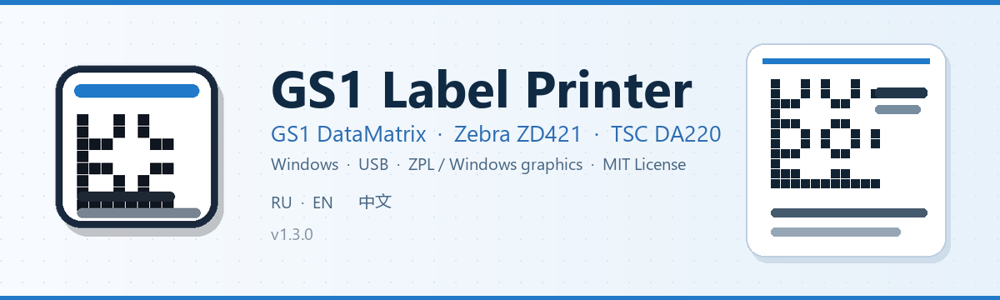
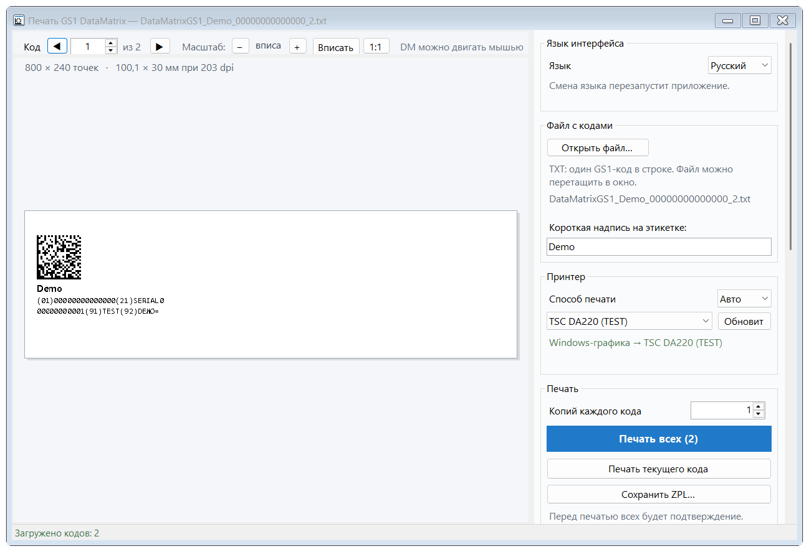
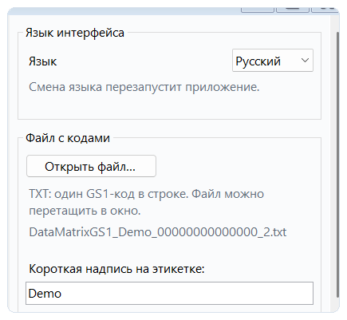
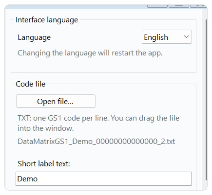
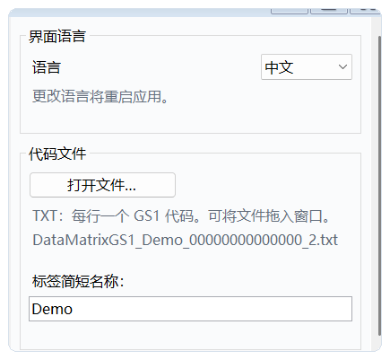

<p align="center">
  
</p>

<p align="center">
  <a href="https://github.com/lopatin2012/LitePrinttingCodes/actions/workflows/build.yml">
    
  </a>
  <a href="https://github.com/lopatin2012/LitePrinttingCodes/releases">
    
  </a>
  <a href="LICENSE">
    
  </a>
  
  
  
</p>

<h1 align="center">GS1 Label Printer</h1>

<p align="center">
  Лёгкое Windows-приложение для печати термоэтикеток с <b>GS1 DataMatrix</b>
  на Zebra ZD421CN, TSC DA220 (USB) и других Windows-принтерах.<br>
  TXT-файл с кодами → предпросмотр → печать по двойному клику.
</p>

<p align="center">
  <b>Русский</b> · <b>English</b> · <b>中文</b> &nbsp;|&nbsp;
  <b>MIT License</b> &nbsp;|&nbsp;
  <b>Windows 10/11 x64</b>
</p>

**English:** A lightweight Windows app for printing GS1 DataMatrix labels on
Zebra ZD421CN (ZPL) and TSC DA220 / other Windows printers (USB or network).
TXT input, draggable barcode, product and code text, append-only TXT job logs,
and a UI in Russian, English or Chinese.

**中文：** 用于 Zebra ZD421CN（ZPL）和 TSC DA220 等 Windows 打印机
（USB 或网络）的 GS1 DataMatrix 标签打印工具。支持 TXT 输入、可拖动条码、
产品与代码文字、TXT 任务文件，以及俄语、英语和中文界面。

<p align="center">
  
</p>

---

## Возможности

- **GS1 DataMatrix ECC200**: ZPL для Zebra или готовая графика через
  Windows-драйвер для TSC DA220 и других USB-принтеров.
- Данные для кода берутся **из выбранного TXT-файла**, один код в строке.
- Автоматически добавляется **FNC1**, разделители `GS (0x1D)` преобразуются
  в FNC1; поддерживается запись GS1 в скобках `(01)…(21)…`.
- Короткая надпись продукта и человекочитаемое содержимое кода под DataMatrix.
- **Перенос строки кода**: `0` — без переноса, `1` — пополам, `2` — на три
  части и т.д.
- DataMatrix **перетаскивается мышью**, положение и размер модуля настраиваются.
- Кириллица печатается как изображение `^GF` и не зависит от шрифтов принтера.
- Выбор принтера, автоматический поиск ZD421/TSC и выбор способа печати:
  **Авто / ZPL (RAW) / Windows (графика)**.
- **Файл задания TXT**: каждый реально отправленный код записывается в файл;
  существующий файл дополняется, новый — создаётся.
- **Три языка интерфейса**: русский, английский, китайский (упрощённый).
- Сохранение текущего ZPL для диагностики.
- Self-test без физического принтера.

---

## Языки интерфейса

Язык выбирается в разделе **Interface language** / **Язык интерфейса** /
**界面语言**. По умолчанию используется язык системы (`ru`, `en` или `zh`).
После смены языка приложение перезапускается.

<table align="center">
  <tr>
    <td align="center"><br><sub>Русский</sub></td>
    <td align="center"><br><sub>English</sub></td>
    <td align="center"><br><sub>中文</sub></td>
  </tr>
</table>

---

## Скачать

Готовый `GS1LabelPrinter.exe` публикуется в
[**Releases**](https://github.com/lopatin2012/LitePrinttingCodes/releases).
Это self-contained single-file: установка .NET не требуется.

Требования: **Windows 10/11 x64** и установленный драйвер принтера:
ZDesigner **ZPL** для Zebra или драйвер **TSC DA220** для USB-печати.

> `.exe` не хранится в git, чтобы не раздувать историю. Сборка и CI создают
> его из исходников; в Releases прилагаются exe, SHA256, README и лицензии.

---

## Быстрый старт

1. Установите драйвер: **ZDesigner … ZPL** для Zebra или **TSC DA220** для TSC.
2. Запустите `GS1LabelPrinter.exe`.
3. В разделе **«Принтер»** выберите нужный принтер (ZD421/TSC обычно
   выбирается автоматически).
4. Оставьте **«Способ печати: Авто»**: Zebra пойдёт через ZPL, TSC — через
   Windows-драйвер.
5. Нажмите **«Открыть файл…»** или перетащите TXT-файл в окно.
6. Проверьте надпись, положение DataMatrix и предпросмотр.
7. Нажмите **«Печать всех»** или **«Печать текущего кода»**.

Перед «Печать всех» показывается подтверждение с количеством этикеток и
именем TXT-задания.

### Способы печати

| Режим | Когда использовать |
|---|---|
| **Авто** | Zebra/ZD421 → ZPL, TSC/другие → Windows-графика. Рекомендуется. |
| **ZPL (RAW)** | Zebra ZPL и другие принтеры с поддержкой ZPL. |
| **Windows (графика)** | TSC DA220 и любые принтеры, установленные в Windows (USB/сеть). |

В режиме графики приложение собирает готовую этикетку в изображение
(DataMatrix + текст) и печатает её через установленный драйвер. Это исправляет
печать на TSC DA220 по USB: принтер не обязан понимать ZPL.

---

## Формат файла

Обычный текст, **один GS1-код в строке**:

```text
(01)00000000000000(21)SERIAL000000000001(91)TEST(92)DEMO=
(01)00000000000000(21)SERIAL000000000002(91)TEST(92)DEMO=
```

Поддерживаются:

- реальные разделители `GS` (`0x1D`) внутри строки;
- GS1-запись в скобках: `(01)…(21)…`;
- строки-комментарии, начинающиеся с `#` (используются в файлах заданий).

Приложение само добавляет **FNC1 в первую позицию** и формирует
человекочитаемую строку `(01)…(21)…` для печати под кодом.

Если имя файла имеет вид
`DataMatrixGS1_<продукт>_<GTIN 14 цифр>_<количество>.txt`,
приложение подставит короткую надпись продукта и GTIN. Надпись можно
изменить — она запоминается для этого GTIN.

Синтетический пример: [`samples/`](samples/).
Не добавляйте в репозиторий реальные GTIN, серийные номера и названия
продуктов — локальные данные держите в `local-data/` (исключена из git).

---

## Файл задания TXT

Каждый код, реально отправленный на принтер, сохраняется в TXT-файл задания.

- Папка по умолчанию: `Документы\GS1 Label Jobs`; её можно изменить в разделе
  **«Файл задания (TXT)»**.
- Новое имя файла: `Job_<GTIN>_<короткий продукт>.txt`.
  Старые файлы `Задание_…` также находятся и дополняются.
- Если файл для этого GTIN уже есть — новые коды **дописываются** в него.
  Если файла нет — создаётся новый.
- В файл попадают только реально отправленные коды: одна строка — одна
  напечатанная этикетка (при копиях код повторяется).
- В начале каждой печати добавляется технический блок комментариев
  (дата, принтер, режим, копии, ожидаемое количество). В конце — сколько
  отправлено; при отмене/ошибке будет соответствующая пометка.
- Старые русские заголовки и новые английские (`# Product:`, `# GTIN:`,
  `# Expected labels:`) распознаются при повторном открытии.
- Если файл задания нельзя открыть/создать, печать не начнётся — чтобы не
  отправить коды без записи.

Чтобы начать для того же GTIN новое задание, переименуйте/перенесите/удалите
старый файл либо выберите другую папку заданий.

---

## Что печатается

- **DataMatrix ECC200, GS1**. Размер символа определяется по содержимому;
  для кодов из примеров — 36×36 модулей. Модуль по умолчанию 3 точки =
  0,375 мм при 203 dpi (символ ≈ 13,5×13,5 мм).
- Под кодом — надпись продукта (15 точек, полужирная) и человекочитаемое
  содержимое кода (13 точек, моноширинный шрифт).
- При перемещении DataMatrix по X текст начинается там же; ширина
  пересчитывается, при необходимости шрифт уменьшается.
- **«Переносов кода»** увеличивает высоту текста; при выходе за этикетку
  появляется предупреждение — поднимите код, уменьшите шрифт/интервал,
  включите перенос или увеличьте высоту этикетки.
- Текст рендерится в изображение: в ZPL — как `^GF`, в режиме Windows —
  как обычный bitmap. Кириллица не зависит от шрифтов Zebra.
- В ZPL размер символа фиксируется (`^BX…,36,36,…`) для стабильной геометрии.
  Галочка «Фиксировать размер символа» отключает это.

### Позиция по умолчанию 19,40

В старом шаблоне `^FO19,160` под кодом не оставалось места: DataMatrix
занимает 108 точек, ещё ~39–57 точек нужны на текст. Поэтому по умолчанию
код поднят вверх (X=19, Y=40), а текст идёт под ним. Положение меняется
перетаскиванием или полями X/Y; «Сброс» возвращает 19,40.

---

## Этикетка и принтер

- По умолчанию: **800 × 240 точек**, 203 dpi = **100,1 × 30,0 мм**.
- Для 300 dpi те же 100 × 30 мм — примерно **1181 × 354 точки**.
  Размеры в приложении задаются в точках; dpi влияет на подсказки в мм.
- **Zebra (ZPL):** команда отправляется через `winspool.drv` с типом `RAW`.
- **TSC DA220 и другие (Windows):** готовая этикетка печатается через
  установленный драйвер (GDI), поэтому USB работает без ZPL.
- Если принтер не найден, приложение не подставляет офисный принтер по
  умолчанию — выберите нужный принтер явно.
- Для TSC DA220: установите драйвер TSC, выберите `TSC DA220`, оставьте
  «Способ печати: Авто» или выберите «Windows (графика)».

---

## Сборка

Требуется **.NET SDK 9** (на целевой машине не нужен).

```powershell
git clone https://github.com/lopatin2012/LitePrinttingCodes.git
cd LitePrinttingCodes
powershell -ExecutionPolicy Bypass -File .\build.ps1
```

Результат: `dist\GS1LabelPrinter.exe` — self-contained single-file,
Windows 10/11 x64, вместе с README, лицензиями и уведомлениями.

### Self-test

```powershell
.\dist\GS1LabelPrinter.exe --selftest .\samples
```

Проверяются разбор файла, GS1-форматирование, ZPL, DataMatrix, перенос
строки кода и дополнение файла задания. В `samples` появятся `selftest.log`
и примеры ZPL; они исключены из git.

### CI и релизы

- [`build.yml`](.github/workflows/build.yml) — сборка, self-test и артефакт
  на `main` / pull request.
- [`release.yml`](.github/workflows/release.yml) — по тегу `v*` собирает
  exe, считает SHA256 и создаёт GitHub Release с документами и лицензиями.
  Текущий тег: **v1.3.0**.
- [`dependabot.yml`](.github/dependabot.yml) — обновления NuGet и Actions.

Релиз вручную:

```powershell
git tag v1.3.0
git push origin v1.3.0
```

---

## Структура проекта

```text
src/GS1LabelPrinter/
  Core/                 разбор файла, GS1, ZPL, DataMatrix, GDI, задания
  UI/                   WinForms-интерфейс и предпросмотр
  app.ico, app.png
  GS1LabelPrinter.csproj
samples/                синтетические тестовые данные
local-data/             локальные реальные данные (исключены из git)
docs/                   баннер и скриншоты для README
.github/                CI, release workflow, dependabot
build.ps1               сборка self-contained exe
LICENSE                 MIT
LICENSES/               тексты лицензий сторонних компонентов
THIRD-PARTY-NOTICES.txt
```

---

## Настройки

Хранятся в:
`%LOCALAPPDATA%\GS1LabelPrinter\settings.json`

Запоминаются принтер, способ печати, последний файл, язык интерфейса,
положение/размеры DataMatrix, шрифты, переносы, папка заданий и надписи
продуктов по GTIN.

---

## Конфиденциальность

- Приложение не использует сеть, не отправляет телеметрию и не передаёт коды
  наружу.
- Печать идёт на локальный/сетевой принтер через Windows-драйвер.
- Файлы заданий и настройки остаются на компьютере.
- В репозиторий не входят реальные производственные данные.

---

## Диагностика

- **«Сохранить ZPL…»** — сохраняет ZPL текущей этикетки для проверки или
  ручной отправки на ZPL-принтер.
- **TSC DA220 по USB не печатает:** выберите принтер `TSC DA220` и способ
  **«Авто»** или **«Windows (графика)»**. Принтер должен быть установлен в
  Windows; raw ZPL для TSC не используется.
- **Пустая этикетка:** для Zebra проверьте ZPL-режим и драйвер; для TSC —
  драйвер TSC, способ «Windows (графика)», размер этикетки 100×30 мм и
  температуру печати.
- **Код не сканируется:** увеличьте модуль (3 → 4–6 точек), проверьте
  контраст и чистоту головки. 3 точки при 203 dpi = 0,375 мм — проверьте
  сканером на реальных этикетках.
- **Текст обрезан снизу:** поднимите DataMatrix, уменьшите шрифт/интервал,
  включите перенос строки кода или увеличьте высоту этикетки.
- **Файл задания не создался:** проверьте права на папку. Если файл нельзя
  открыть/создать, печать не начнётся.
- **SmartScreen:** exe не подписан; при первом запуске выберите
  «Подробнее» → «Выполнить всё равно».

---

## Ограничения

- Windows 10/11 x64; WinForms и GDI+.
- Один TXT-файл — один продукт/партия; строки читаются как коды.
- Excel (`.xlsx`) напрямую не читается — сохраните лист как TXT.
- Печать через Windows-драйвер (ZPL или графика); принтер должен быть
  установлен в системе.
- Перед промышленной печатью сделайте тестовую этикетку на реальном принтере
  и проверьте её GS1-сканером.

---

## Лицензия

Код проекта — **MIT**: свободное использование, изменение и распространение,
включая коммерческое, при сохранении уведомления об авторских правах.
См. [LICENSE](LICENSE).

Сторонние компоненты:

- **ZXing.Net** — Apache License 2.0;
- **.NET 9 / Windows Forms** — MIT.

Полные тексты — в [`LICENSES/`](LICENSES/), подробности —
в [THIRD-PARTY-NOTICES.txt](THIRD-PARTY-NOTICES.txt).

Zebra, ZDesigner и ZD421 — товарные знаки Zebra Technologies. TSC и DA220 —
товарные знаки TSC Auto ID Technology. GS1 — товарный знак GS1 AISBL.
Проект не связан с этими компаниями.

---

<p align="center">
  <a href="https://github.com/lopatin2012/LitePrinttingCodes">
    github.com/lopatin2012/LitePrinttingCodes
  </a>
  <br>
  <sub>Если проект полезен — поставьте ⭐</sub>
</p>
